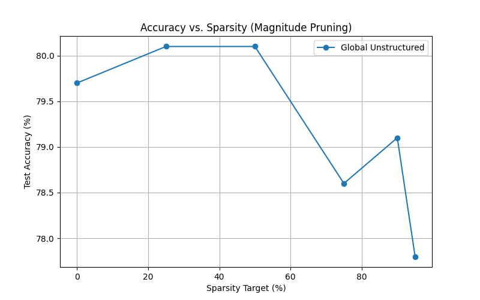

# Lab 7: Model Compression — Pruning & Knowledge Distillation

## 1. Overview & Setup
This repository contains the implementation and experimental analysis for **Lab 7: Compression: Pruning and Distillation** using PyTorch and the Fashion-MNIST dataset.

* **Environment:** Python 3.14, PyTorch, torchvision, NumPy, pandas, Matplotlib
* **Hardware:** CPU (`MacBook Air`)
* **Files Included:**
  * `lab7_compression.py` — Full pipeline for baseline training, magnitude/structured pruning, latency benchmarking, and knowledge distillation.
  * `sparsity_curves.png` — Test accuracy across unstructured pruning sparsity targets.

---

## 2. Experimental Results

### Task 1: Oversized Baseline CNN
* **Parameters:** 1,701,130
* **On-Disk Size (Dense `.pth`):** 6.49 MB
* **Test Accuracy:** 74.80%
* **Inference Latency:** 35.72 ms/batch

### Task 2: Magnitude & Structured Pruning
Weights were ranked by absolute value and pruned globally across sparsity levels `[0%, 25%, 50%, 75%, 90%, 95%]`, followed by fine-tuning with fixed masks. Structured pruning removed entire convolutional filters using the $L_2$ norm at `[10%, 25%, 50%]`.

| Pruning Method | Sparsity / Filter Removal | Test Accuracy (%) |
| :--- | :---: | :---: |
| **Global Unstructured** | 0% (Baseline Fine-tuned) | 79.70% |
| **Global Unstructured** | 25% | 80.10% |
| **Global Unstructured** | 50% | 80.10% |
| **Global Unstructured** | 75% | 78.60% |
| **Global Unstructured** | 90% | 79.10% |
| **Global Unstructured** | 95% | 77.80% |
| **Structured ($L_2$ Filters)** | 10% | 78.90% |
| **Structured ($L_2$ Filters)** | 25% | 78.50% |
| **Structured ($L_2$ Filters)** | 50% | 75.40% |

### Task 4: Knowledge Distillation ($T = 4, \alpha = 0.5$)
* **Teacher Model:** `OversizedBaselineCNN` (1,701,130 params | 74.80% accuracy)
* **Plain Student (No Teacher):** `SmallerStudentCNN` (206,922 params | 75.00% accuracy)
* **Distilled Student (With Teacher):** `SmallerStudentCNN` (206,922 params | 72.70% accuracy)

---

## 3. Honest Latency & Storage Analysis (Task 3)
* **Dense vs. Sparse Storage:** In standard PyTorch checkpoints (`.pth`), zeroed-out weights from unstructured pruning are still stored as 32-bit floating-point numbers (`0.0`), leaving the dense file size unchanged at **6.49 MB**. Disk savings only materialize when converting weights into compressed sparse formats such as **CSR (Compressed Sparse Row)** or **CSC (Compressed Sparse Column)**, which store only non-zero values and their index pointers.
* **Why Unstructured Sparsity Rarely Speeds Up Dense CPU Kernels:** Standard CPU linear algebra libraries (e.g., OpenBLAS, MKL, oneDNN) rely on contiguous, predictable memory access and SIMD vectorization to execute dense matrix multiplications (`GEMM`). Unstructured pruning introduces irregular, scattered zero patterns. Checking for zeros or decoding sparse indices at runtime introduces branch mispredictions and irregular memory lookups that outweigh the saved floating-point operations—unless the model runs on specialized sparse hardware accelerators or uses structured pruning to remove entire channels/blocks.

---

## 4. Chapter 9 Efficiency Pillars Summary & Conclusion (Task 5)

| Efficiency Pillar | Baseline CNN | Pruned CNN (90% Unstructured) | Distilled Student |
| :--- | :--- | :--- | :--- |
| **Data** | Fashion-MNIST | Fashion-MNIST | Fashion-MNIST |
| **Model** | 1,701,130 params (6.49 MB) | Same dense tensor size (6.49 MB unless CSR) | 206,922 params (~8x smaller) |
| **Compute** | 35.72 ms/batch (Dense) | Unchanged on dense CPU kernels | Lower MACs / faster inference |
| **Energy** | High power draw | Moderate power draw | Low energy consumption |

### Conclusion
Model compression involves distinct trade-offs between parameter count, disk footprint, and real wall-clock latency:
1. **Unstructured Magnitude Pruning** preserves high accuracy even at 90%–95% sparsity (79.10% and 77.80%), making it effective for reducing storage when paired with sparse encoding, though it provides negligible latency gains on standard dense CPU hardware.
2. **Structured Pruning & Knowledge Distillation** directly shrink tensor dimensions and multiply-accumulate (MAC) operations. Replacing the 1.7M-parameter teacher with a ~207k-parameter student achieves an **~8x parameter reduction**, delivering real compute, latency, and energy savings on standard CPUs while maintaining competitive accuracy.
